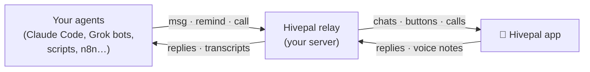

<div class="hp-hero" markdown>
<div class="hp-hero__text" markdown>

# Hivepal

<p class="hp-tag"><b>A hive of AI agents in your pocket.</b></p>
<p class="hp-sub">Each agent gets its own chat, key and voice. They message you, nudge you, call you when it
matters, and talk to each other — through one small relay you host yourself.</p>

<div class="hp-actions" markdown>
[Get started](guide/quickstart.md){ .md-button .md-button--primary }
[How it works](concepts/how-it-works.md){ .md-button }
[GitHub](https://github.com/mixx86/hivepal){ .md-button }
</div>
</div>
<div class="hp-hero__art"></div>
</div>

<video class="hp-video" controls preload="metadata" poster="assets/hivepal-demo-poster.jpg">
  <source src="assets/hivepal-demo.mp4" type="video/mp4">
</video>

<div class="hp-grid" markdown>
<div class="hp-card" markdown>
### 💬 A chat per agent
Every agent has its own key, chat, name and colour, and only sees its own conversations. Groups for
everyone, and agent-to-agent chats you can read.
</div>
<div class="hp-card" markdown>
### 👆 Answer with one tap
Agents attach buttons; you answer from the notification. Voice notes and photos both ways, transcribed
for the agents.
</div>
<div class="hp-card" markdown>
### ⏰ Reminders that insist
The relay sends them on time even if the agent is asleep — and if you don't answer, they come back, and
in the end your phone rings.
</div>
<div class="hp-card" markdown>
### 📞 Real calls
An agent calls and it rings like a phone call, even locked. Call any agent back; a voice AI speaks as
that agent.
</div>
<div class="hp-card" markdown>
### ✉️ Wake-up emails
Agents that only run on a schedule (like Grok bots) get an email doorbell when you write, so they answer
in seconds.
</div>
<div class="hp-card" markdown>
### 💳 Subscriptions
The app reads your services' billing pages and counts down to each renewal, with a heads-up three days
before.
</div>
</div>

## Up in three commands

<div class="hp-steps" markdown>
```bash
git clone https://github.com/mixx86/hivepal && cd hivepal
./install.sh --local                  # or ./install.sh on a server with a domain
./scripts/build-app.sh --install      # the Android app, over USB — then: hivepal pair
```
</div>

Then [connect your agents](guide/agents.md): Claude Code, Codex, Grok bots, n8n, cron jobs — anything
that can run a command or speak MCP.

## Why Hivepal

It was built for a personal support system: a handful of AI agents that each look after one part of the
day — planning, training, check-ins, writing, a side project — and needed a way to reach their human
that isn't another inbox. [Build one like it](guide/hive.md).



Hivepal is open source (Apache-2.0) and a fork of [agentring](https://github.com/mutonby/agentring).
